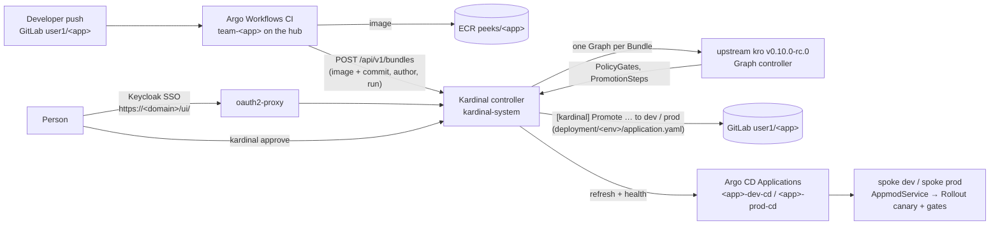

# Progressive delivery with Kardinal

[Kardinal](https://pnz1990.github.io/kardinal-promoter/) (kardinal-promoter v0.11.0) promotes
applications from dev to prod. It replaced Kargo on this branch. Argo Rollouts still runs the
canary and its quality gates on the spokes; Kardinal decides **which version** goes **where** and
**when**, and writes each promotion as a Git commit that Argo CD deploys.

- [Architecture](#architecture)
- [Why upstream kro on the hub, and the way back](#why-upstream-kro-on-the-hub-and-the-way-back)
- [How a promotion works](#how-a-promotion-works)
- [Sign-in and permissions](#sign-in-and-permissions)
- [Workshop: "Production deploy with Kardinal"](#workshop-page-production-deploy-with-kardinal-replaces-304) (replaces module 30.4)
- [Operating it](#operating-it)
- [Upgrading a running stack from Kargo](#upgrading-a-running-stack-from-kargo)
- [Known gaps](#known-gaps)

## Architecture



On the **hub**:

| Piece | Where | What it does |
|---|---|---|
| `kro-upstream` addon | `gitops/addons/charts/kro-upstream`, registry `platform.yaml` | Self-managed upstream kro **v0.10.0-rc.0** with the `GraphKind` feature (Kardinal builds one `kro.run/v1alpha1` Graph per Bundle). It also runs every hub RGD, in place of the EKS managed kro capability (`kroCapability.enabled: "false"` on the hub's EksCluster). |
| `kardinal` addon | `gitops/addons/charts/kardinal` (umbrella over `oci://ghcr.io/pnz1990/charts/kardinal-promoter` 0.11.0), registry `gitops.yaml` | The controller, the Kardinal CRDs and admission policies. External Secrets for the controller's GitLab token (`<hub>/secrets.git_token`), a generated Bundle API token, and a read-only ClusterSecretStore (`kardinal-bundle-api`) through which the `team-*` CI namespaces copy that token. The UI's SSO (`sso`, see below). |
| Per app | namespace `<app>-app` | Pipeline `<app>` (dev then prod, `update.strategy: yaml` on `deployment/<env>/application.yaml` `spec.image`, `health.type: argocd` on `<app>-<env>-cd`), PolicyGate `prod-approval` (1 approval), ExternalSecret `gitlab-git` (the Pipeline's git token, `kardinal.io/referenceable`). Synced by the Argo CD Application `<app>-kardinal`. |
| CI glue | `cicd-pipeline` RGD, `spec.kardinal.enabled: "true"` | After the image push, CI's `create-bundle` step POSTs a Bundle (image, commit SHA, GitLab author, Argo Workflows run URL) instead of writing `deployment/dev` itself, so one writer owns each environment. The one-shot `initial` build creates no Bundle. |
| Backstage | `platform/backstage/templates/cicd-pipeline`, parameter `promoter` (default `kardinal`) | Sets `kardinal.enabled` and adds `<app>-kardinal` plus the `kardinal/` objects to the generated `<app>-cicd` repo. No script to run. |

The **spokes** are unchanged: managed kro 0.9.4-eks-1 runs the AppmodService RGD, Argo Rollouts
runs the canary with the functional, performance and metrics gates. Kardinal never talks to the
spokes. It reads the hub's Argo CD Applications, which turn Healthy only when the spoke Rollout is
Healthy (#977).

**DORA** is unchanged. Kardinal's prod commit is a push to `deployment/prod/`, so the CI Sensor's
`prod-deploy-webhook` records the PRODUCTION deployment in DevLake, attributed to the build commit,
exactly as for a manual or Kargo promotion. Kardinal's own numbers are in
`Pipeline.status.deploymentMetrics` (`kardinal metrics`).

`stamp-build-time` stays in CI for now. Kargo's NewestBuild read the manifest annotation it sets.
Kardinal's NewestBuild (an OCI Subscription) reads the image config's `created` time, which kaniko
already sets to the build time, so the step can go once the Subscription exploration is done.

## Why upstream kro on the hub, and the way back

Kardinal needs kro's **Graph** API (`graphs.kro.run`), which only upstream kro ≥ v0.10.0-rc.0 serves
with the `GraphKind` gate. The EKS managed kro capability (0.9.4-eks-1) does not have it. Two kro
controllers cannot share one API server: both reconcile every ResourceGraphDefinition, the
GraphRevisions and the generated CRDs, with the same finalizer and field manager. So the hub runs
upstream kro **instead of** the capability:

- the `rg-eks` flag `kroCapability.enabled` (default `"true"`; the hub claim sets `"false"` when
  `hub.kroMode: upstream`, the workshop default on this branch);
- the `kro-upstream` addon, enabled by the hub label `enable_kro_upstream` (seeded with
  `enable_kardinal` by `secrets-manager:seed` in upstream mode).

A live hub was swapped in place: deleting the capability keeps every RGD, instance and child, and
upstream kro adopts them with the same UIDs (checked first on a throwaway spoke, then on the
workshop hub, with all 170 ACK resources keeping their AWS IDs). The spokes keep the capability.

**The way back**, once the managed capability serves Graph with an RBAC model Kardinal's
aggregation and impersonation work with (not run yet; the reverse of the tested swap).
**Never let both kro controllers run.**

1. Let in-flight promotions finish and pause the Pipelines (`kardinal pause <app> -n <app>-app`).
   Delete every `graphs.kro.run` object while upstream kro still runs (Graphs carry
   `kro.run/graph-finalizer`); Kardinal builds new ones for new Bundles. Whether a Graph-capable
   capability could adopt them in place instead is untested.
2. Remove `enable_kro_upstream`. The ApplicationSet keeps the resources
   (`preserveResourcesOnDeletion`), so kro keeps running: delete by hand, in `kro-system`, the
   Deployment and ServiceAccount `kro`, and the ClusterRoles `kro:controller`,
   `kro:controller:static`, `kro-edit`, `kro-view` and ClusterRoleBinding `kro:controller`.
   **Not the CRDs.** Never delete the `kro-upstream` Application with cascading delete or follow
   Kardinal's uninstall instructions: those remove `resourcegraphdefinitions.kro.run`, and every
   RGD and instance with it. Check that no kro pod runs and the lease `kro-system/controller.kro.run`
   stops renewing.
3. Only then set `kroCapability.enabled: "true"` on the hub's EksCluster (or `hub.kroMode:
   managed` for new installs). EKS creates the capability, which takes the RGDs and instances
   back in place, as tested on a spoke. The retained IAM role `<hub>-kro-capability-role` is
   re-adopted.
4. Resume the Pipelines; `kardinal doctor` must show `kro Graph CRD installed`.

## How a promotion works

1. **A version.** CI creates a **Bundle**: the image plus provenance (commit, author, CI run). A
   newer Bundle of the same Pipeline **supersedes** one still in flight; its unfinished steps are
   cancelled.
2. **A Graph.** For each Bundle, Kardinal builds a kro Graph. kro creates the environment's
   **PolicyGates** (instances of the namespace's gate templates, `kardinal.io/applies-to: <env>`)
   and, once they are all ready, the environment's **PromotionStep**.
3. **A step.** The PromotionStep clones `user1/<app>`, sets `spec.image` in
   `deployment/<env>/application.yaml`, commits `[kardinal] Promote <bundle> to <env>` as
   `kardinal-promoter`, pushes to `main`, and asks Argo CD to sync (the
   `argocd.argoproj.io/refresh` annotation; Kargo's `argocd-update` did the same). It then waits
   until `<app>-<env>-cd` is Healthy and Synced at that commit (timeout 20 m). The canary and its
   gates run in that time.
4. **dev, then prod.** dev has no gate and is promoted at once. prod waits at `prod-approval`:
   the PromotionStep for prod does not exist until someone approves (and nobody declines). The
   approval is an `Approval` object with the approver's verified identity.
5. **Look inside.** `kardinal explain <app> -n <app>-app` shows every gate's expression and reason;
   `kardinal get bundles -n <app>-app` the versions and their phases (Promoting, Verified,
   Superseded, Failed); `kubectl get auditevents -n <app>-app` the history.

## Sign-in and permissions

The UI is at **`https://<domain>/ui/`** (`$KARDINAL_URL` on the IDE; the Backstage home page links
it). Its asset and API paths are absolute, so it is served at the root prefixes `/ui` and
`/api/v1/ui` of the shared platform ALB, not under `/kardinal`.

Kardinal has no OIDC login of its own. It authenticates every UI API call with a Kubernetes
**TokenReview** and authorizes it with a **SubjectAccessReview** for that user. The addon wires
Keycloak into that:

1. **oauth2-proxy** (`kardinal-system/kardinal-promoter-oauth2-proxy`, Keycloak client `kardinal`,
   PKCE) signs the user in and forwards their **Keycloak ID token** as `Authorization: Bearer` to
   the UI. Its own endpoints are under `/ui/oauth2`; `/ui/logo.png` is public for Backstage's link.
2. An **EKS OIDC identity provider** (ACK `IdentityProviderConfig peeks-hub/<hub>-keycloak`) makes
   the hub's API server accept those ID tokens, as user `oidc:<username>` with groups
   `oidc:<group>`. The prefixes keep Keycloak names apart from IAM and ServiceAccount users. EKS
   allows one OIDC provider per cluster.
3. Kardinal runs with `ui.auth.tokenReview=true`, `tokenReview.acceptAPIServerAudience=true` (an
   OIDC ID token reviews with the API server's audience, not `kardinal-promoter`), and
   `ui.allowedHosts=[<domain>]`.
4. **RBAC** (ClusterRoleBindings `kardinal-sso-*`): Keycloak groups admin, editor and viewer get the
   chart's **viewer** role; **admin** also gets **promoter** and **approver**.

| Keycloak user | Can |
|---|---|
| user1 (admin) | see every pipeline, approve and decline prod, promote, roll back, pause |
| user2 (editor), user3 (viewer) | see every pipeline; the Approvals page shows prod approvals as "waiting on someone else", and the API answers 403 |

On the IDE, `kardinal` (installed by `task ide:kardinal-cli`, aliased to `--context <hub>`) acts
as the participant's IAM identity, which is cluster-admin on the hub. Its approvals are recorded
under that ARN.

`acceptAPIServerAudience` is shared by the UI and the Bundle API (one Kardinal setting). With the
Bundle API's TokenReview mode on, it also accepts API-server-audience tokens there; RBAC still
decides who may create Bundles.

## Workshop page: "Production deploy with Kardinal" (replaces 30.4)

The workshop content lives outside this repository. Use the text below in place of
`30_ProgressiveApplicationDelivery/40_production-deploy-kargo/index.en.md`. It assumes 30.2 created
`java-cicd` with the Backstage template's default **Promoter: Kardinal** (the template's new
"Promotion" step). In 30.2 and 30.3 the changes are small. The commit that sets the new image in
`deployment/dev/application.yaml` now comes from `kardinal-promoter`, not from the CI pipeline, and
Kardinal asks Argo CD to sync dev itself; `argocd app sync java-dev-cd` still works but is no longer
needed.

---

**Multi Stage GitOps Application Orchestration with Kardinal**

In this section, we use [Kardinal](https://pnz1990.github.io/kardinal-promoter/) to promote our
Java application from DEV to PROD with one approval. Kardinal promotes the **same image** that
passed DEV, and every promotion is a Git commit that Argo CD deploys.

**CI/CD flow with Kardinal:**

1. A developer pushes code to the Git repository.
2. Argo Workflows builds the image, pushes it to ECR, and hands it to Kardinal as a **Bundle** (a
   version), together with the commit and its author.
3. Kardinal commits the image to `deployment/dev/application.yaml` and asks Argo CD to sync DEV.
   The canary and its functional and performance gates run there.
4. When DEV is Healthy, the version waits at the `prod-approval` gate.
5. You approve it in the Kardinal UI (or with `kardinal approve`). Kardinal commits the same image
   to `deployment/prod/application.yaml` and Argo CD deploys PROD.

*Kardinal concepts:*
- **Pipeline**: the app's environments in order (dev, then prod), how to update them and how to
  check that they are healthy.
- **Bundle**: one version of the app, here an image built by CI.
- **PolicyGate**: a rule an environment must pass. `prod-approval` waits for one person.
- **PromotionStep**: one environment's promotion of one Bundle: clone, update, commit, push, sync,
  wait for Healthy.

**Creating the production manifest.** PROD needs its own manifest, like DEV. We start PROD on the
`initial` image (the one CI built when the pipeline was created), so you can watch Kardinal replace
it with the version DEV validated. This module uses the **kro** manifest, which Kardinal updates at
`spec.image` (see the note at the end for KubeVela).

```bash
export RESOURCE_PREFIX=${RESOURCE_PREFIX:-peeks}
export CLUSTER_NAME=${RESOURCE_PREFIX}-spoke-prod
cd ~/environment/applications/java
git pull --rebase
envsubst '${RESOURCE_PREFIX} ${CLUSTER_NAME}' \
  < deployment/templates/kro/application.yaml \
  > deployment/prod/application.yaml
cp deployment/templates/kro/services.yaml deployment/prod/services.yaml
sed -i -e "s|<image>|${AWS_ACCOUNT_ID}.dkr.ecr.${AWS_REGION}.amazonaws.com/${RESOURCE_PREFIX}/java:initial|" \
       -e 's/value: "DEV"/value: "PROD"/' \
       -e 's/extraArgs: "red"/extraArgs: "orange"/' \
       deployment/prod/application.yaml
git add deployment/prod/
git commit -m "Add production deployment manifest"
git pull --rebase && git push
```

**Your Kardinal pipeline.** The Backstage template created it with `java-cicd`. Check it:

```bash
kardinal get pipelines -A
kardinal explain java -n java-app
```

`java` shows the version live in DEV, and `explain` shows `prod-approval` **Blocking**:
`waiting for approvals: 0 of 1`. (If `kardinal get pipelines -A` lists no `java`, your `java-cicd`
was created with Promoter "None": run `~/environment/applications/java/kardinal/deploy-kardinal.sh`
once, then push a code change so CI creates a version.)

**Open the Kardinal UI:**

```bash
open $KARDINAL_URL
```

You sign in with Keycloak, the same way as for Backstage (already signed in? Then it just opens).
The **Fleet** view shows `java` with DEV and PROD; select it for the promotion graph. **Approvals**
in the top bar shows what waits for you.

*Step 1: Verify DEV.* The DEV page should be orange with environment `version 2`:

```bash
[ -z "$DNS_DEV" ] && export DNS_DEV=$(kubectl --context ${RESOURCE_PREFIX}-spoke-dev get ingress -n team-java -o jsonpath='{.items[0].status.loadBalancer.ingress[0].hostname}')
open_when_ready "http://$DNS_DEV/java-app/java-app/"
```

*Step 2: Approve the promotion to PROD.* In the Kardinal UI:

1. Open **Approvals**. `java › prod` waits on you, with the version (the image tag) and
   `prod-approval · 0 of 1`.
2. Click **Approve**, add a comment if you like (e.g. "checked the DEV canary"), and confirm.
3. The UI answers `Approved. Recorded: oidc:user1 approves … for prod`. The pipeline turns
   **Promoting**, then **Verified** in PROD after the canary finishes (2-3 minutes).

Or from the terminal:

```bash
kardinal inbox -A
kardinal approve java prod -n java-app
```

Kardinal records who approved: `oidc:user1` from the UI (your Keycloak user), your IAM role from
the CLI. Users without the approver role (try `user2`) see the approval as "waiting on someone
else" and cannot approve.

*Step 3: Verify PROD.*

```bash
cd ~/environment/applications/java
git pull
git log -1 --format='%an: %s' -- deployment/prod
grep 'image:' deployment/prod/application.yaml
```

The last commit is `kardinal-promoter: [kardinal] Promote java-… to prod`, and the image is the
one DEV runs (`kardinal get bundles -n java-app` lists it as Verified). Kardinal asked Argo CD to
sync `java-prod-cd`; to check the new functional gate there:

```bash
prod
kubectl get analysistemplate functional-gate-java-webservice -n team-java -o jsonpath='{.spec.metrics[0].provider.job.spec.template.spec.containers[0].args[1]}' | grep -o "Testing for: [a-z]*"
[ -z "$DNS_PROD" ] && export DNS_PROD=$(kubectl --context ${RESOURCE_PREFIX}-spoke-prod get ingress -n team-java -o jsonpath='{.items[0].status.loadBalancer.ingress[0].hostname}')
open_when_ready http://$DNS_PROD/java-app/java-app/
hub
```

You promoted your Java application from DEV to PROD with Kardinal. Each further code change goes
the same way: CI → DEV automatically → PROD after an approval. The Measuring Platform Success
section shows the PROD deployment in DevLake, as before.

> **KubeVela manifests.** Kardinal sets one path per environment. The template's Pipeline sets
> `spec.image` (kro). For KubeVela, change `path` in `kardinal/pipeline.yaml` of your `java-cicd`
> repo to `spec.components[0].properties.image`. Kardinal cannot bump the
> `app.oam.dev/publishVersion` annotation (keys with `.` or `/` are not addressable), so a
> KubeVela promotion may also need that annotation changed by hand.

---

## Operating it

| | |
|---|---|
| UI | `https://<domain>/ui/` (`$KARDINAL_URL`; `task urls` prints it in upstream mode) |
| CLI | `kardinal get pipelines -A`, `inbox -A`, `explain <app> -n <app>-app`, `approve <app> prod -n <app>-app`, `get bundles -n <app>-app`, `rollback`, `pause`, `doctor` |
| Health | `kardinal doctor` (controller, CRDs, kro, Graph CRD, GitLab token); Applications `kro-upstream-<hub>`, `kardinal-<hub>`, `<app>-kardinal` |
| Logs | `kubectl -n kardinal-system logs deploy/kardinal-promoter` (each UI and Bundle API call is logged with user and result), `deploy/kardinal-promoter-oauth2-proxy` |

Troubleshooting (seen on the live stack):

| Symptom | Cause / fix |
|---|---|
| UI API 401 right after a fresh install | the EKS identity provider association takes about 5-30 minutes, and requests can be refused for about a minute after it turns ACTIVE |
| A Keycloak user signs in but sees no pipelines | no binding for their group: add it to `sso.roleBindings` |
| A step waits 20 minutes, then the Bundle fails | the canary aborted: the Argo CD Application shows Progressing, not Degraded, because it tracks the AppmodService, not the Rollout. Check `kubectl argo rollouts get rollout` on the spoke. A newer Bundle supersedes the stuck one |
| dev waits for Argo CD's poll after a version that changed nothing | kardinal-promoter #1910 (no refresh for a no-change step) |
| The Backstage home page still links Kargo | Backstage reads app-config at start: `kubectl -n backstage rollout restart deploy/backstage` |

## Upgrading a running stack from Kargo

Moving a stack's addons to this branch is not enough on its own. The `kargo` ApplicationSet keeps
Kargo's resources when it stops matching (`preserveResourcesOnDeletion`), and cluster-addons does
not prune. Also, if the stack still reads its **fleet** values from a repo that enables kargo,
the hub keeps the `enable_kargo` label. The workshop overlay sets `kargo: false` for that; with an
older fleet-config, use `overlays/clusters/<hub>/addon-overrides.yaml` with
`enabledAddons: {kargo: false}`. Then:

1. Make sure no Kargo Project is left (`kubectl get projects.kargo.akuity.io`). Java's
   `deploy-kardinal.sh` deletes java's.
2. Once cluster-addons shows the `kargo` ApplicationSet as requiring pruning, set
   `spec.syncPolicy.preserveResourcesOnDeletion: false` on it.
3. Remove the label (fleet-secret refresh). The ApplicationSet deletes `kargo-<hub>`, and Argo CD
   deletes Kargo's resources. The controller's ServiceAccount keeps the finalizer
   `kargo.akuity.io/finalizer`, which only the deleted controller would remove: remove it by hand.
4. Delete what Argo CD keeps: the nine `*.kargo.akuity.io` CRDs (no instances left), the `kargo`
   namespace, the `kargo` ApplicationSet.
5. Delete what `deploy-kargo.sh` created imperatively: the Pod Identity association
   (`<hub>`, `kargo/kargo-controller`) and the IAM role `<prefix>-hub-kargo-controller-role`
   (detach `AmazonEC2ContainerRegistryReadOnly` first).
6. Keycloak's config job deletes the `kargo` client on its next run, and `task setup-env` replaces
   `KARGO_URL` with `KARDINAL_URL`. Restart Backstage for the new home-page links.

## Cleanup

`scripts/validation/cleanup-modules-20-30.sh` removes what modules 20 and 30 created, Kardinal
included: the `<app>-cicd`, `<app>-kardinal`, `<app>-dev-cd` and `<app>-prod-cd` Applications, the
AppProject, the CICDPipeline, Kardinal's `<app>-app` namespace (Pipeline, gates, Bundles,
Approvals, AuditEvents), the spoke namespaces on dev **and** prod, ECR, the catalog entity and the
GitLab `<app>-cicd` repo (for good, so the template can create it again). It resets `deployment/dev`
and `deployment/prod` in the app repos. `APPS="rust java"` by default. Set `APPS=<app> NEXTJS=no`
to clean one app only.

## Known gaps

- **kind-crossplane hubs have no promoter.** Their hub always runs the managed kro capability, so
  the `kardinal` addon cannot run there, and Kargo is gone.
- **KubeVela**: one image path per environment, and no `publishVersion` bump (above).
- **Alpha software on an RC**: `kardinal.io/v1alpha1` on kro v0.10.0-rc.0; pin both, as the
  addons do.
- **One OIDC identity provider per EKS cluster**: the hub's is Keycloak, for the Kardinal UI.
- **Backstage** has no config checksum: app-config changes need a restart (all of them, not only
  the Kardinal link).
